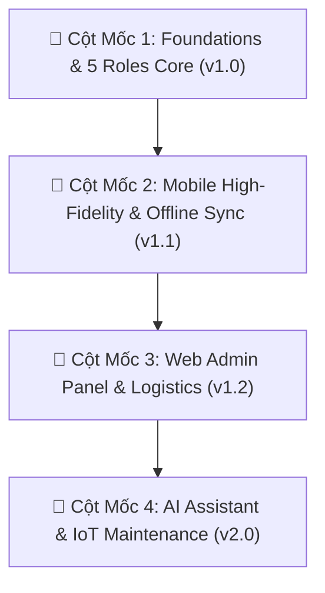

# WikiAlisa Kit — Dự án Lộ Trình Phát Triển (Project Roadmap)

Lộ trình phát triển chính thức của **WikiAlisa Kit & Agriculture Solar Pump Management System**.
Theo dõi trực tuyến tại: **[`https://github.com/users/wikialisa/projects/3`](https://github.com/users/wikialisa/projects/3)** và **[`https://github.com/wikialisa/UI/milestones`](https://github.com/wikialisa/UI/milestones)**.

---

## 🎯 Bảng Cột Mốc (Milestones & Epics)

---

### 📍 Cột Mốc 1: Foundations & 5 Roles Core (v1.0)
*Mục tiêu: Hoàn thiện Design Tokens, Atomic Components, và luồng nghiệp vụ 5 vai trò thực địa.*
- [x] **[#1]** Thiết lập Design Tokens W3C (48 Colors, 14 Spacing 8pt, Inter Typography)
- [x] **[#2]** Xây dựng 27 Master Components chuẩn Atomic Design (React Native, Flutter, HTML)
- [x] **[#3]** Chuẩn hóa quy trình 20 bước và luồng 5 vai trò thực địa (Delivery, Install, QA, Tech, Farmer)

---

### 📍 Cột Mốc 2: Mobile High-Fidelity & Offline Sync (v1.1)
*Mục tiêu: 49 Màn hình di động 390px, cơ chế Offline-First và đồng bộ đám mây SQLite.*
- [ ] **[#4]** Thiết kế & Triển khai 49 màn hình di động chuẩn 390px (Del 01 -> 18, Auth, QA, Tech, Farmer)
- [ ] **[#5]** Xây dựng cơ chế Offline-First & Đồng bộ dữ liệu thực địa (Offline Banner, Sync Counter `☁️ 3`, WatermelonDB)

---

### 📍 Cột Mốc 3: Web Admin Panel & Logistics (v1.2)
*Mục tiêu: Bảng điều khiển quản trị Desktop: Operations, Kho vật tư, Điều phối và KPI Dashboard.*
- [ ] **[#6]** Phát triển Web Admin Panel quản lý Operations & Tồn kho Warehouse (Tấm pin, Inverter, Bơm)
- [ ] **[#7]** Xây dựng Dashboard KPIs năng lượng mặt trời và lưu lượng tưới (MWh điện, m³ nước sạch)

---

### 📍 Cột Mốc 4: AI Assistant & IoT Maintenance (v2.0)
*Mục tiêu: AI nhận diện góc nghiêng tấm pin, Trợ lý giọng nói cho nông dân và Bảo trì dự đoán.*
- [ ] **[#8]** Tích hợp AI hỗ trợ canh chỉnh góc nghiêng dàn pin & Chẩn đoán lỗi mã biến tần
- [ ] **[#9]** Trợ lý giọng nói tiếng Việt cho nông dân & Bảo trì dự đoán hỏng hóc quạt/pin
