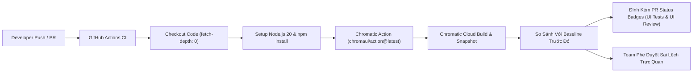

# Hướng Dẫn Tự Động Hóa Kiểm Thử Thị Giác Với Chromatic & CI (Automate with CI)

> Tự động hóa kiểm thử giao diện trực quan (Visual Regression Testing & UI Review) trên GitHub Actions CI cho thư viện thiết kế **WikiAlisa UI**.

---

## 1. Tổng Quan Kiến Trúc CI/CD



---

## 2. Cấu Hình Secret `CHROMATIC_PROJECT_TOKEN` Trên GitHub

Để quy trình GitHub Actions có thể gửi các bản chụp giao diện tới Chromatic:

1. Đăng nhập vào [Chromatic](https://www.chromatic.com/) và tạo / chọn dự án liên kết với repository [`wikialisa/UI`](https://github.com/wikialisa/UI).
2. Vào phần **Manage** ➔ **Configure** và sao chép **Project Token** (dạng `chpt_xxxxxxxxxxxx`).
3. Truy cập GitHub repository: [github.com/wikialisa/UI/settings/secrets/actions](https://github.com/wikialisa/UI/settings/secrets/actions).
4. Nhấn **New repository secret**:
   - **Name**: `CHROMATIC_PROJECT_TOKEN`
   - **Secret**: *Dán mã token lấy từ Chromatic vào đây*.
5. Nhấn **Add secret**.

---

## 3. Cấu Hình `package.json`

Root `package.json` đã được bổ sung script và devDependency:

```json
{
  "scripts": {
    "chromatic": "chromatic --exit-zero-on-changes",
    "chromatic:ci": "chromatic --exit-zero-on-changes --auto-accept-changes",
    "test:visual": "npm run chromatic"
  },
  "devDependencies": {
    "chromatic": "^11.18.0"
  }
}
```

- `--exit-zero-on-changes`: Cho phép CI tiếp tục ngay cả khi có thay đổi thị giác phát hiện được, giúp lập trình viên review và chấp thuận trên giao diện web của Chromatic mà không làm hỏng pipeline CI.
- `--auto-accept-changes`: Tự động chấp thuận baseline mới khi code được merge vào nhánh chính (`main`).

---

## 4. Workflow GitHub Actions (`deploy/chromatic-workflow.yml`)

File cấu hình workflow mẫu nằm sẵn tại [`deploy/chromatic-workflow.yml`](../deploy/chromatic-workflow.yml), tự động kích hoạt mỗi khi có commit hoặc Pull Request tới nhánh `main`:

```yaml
name: 'Chromatic Visual Tests'

on:
  push:
    branches: [ main ]
  pull_request:
    branches: [ main ]
  workflow_dispatch:

jobs:
  chromatic:
    name: 'Run Chromatic Visual Tests'
    runs-on: ubuntu-latest
    steps:
      - name: Checkout Repository
        uses: actions/checkout@v4
        with:
          fetch-depth: 0 # Bắt buộc: Chromatic cần toàn bộ lịch sử git để xác định commit gốc (baseline)

      - name: Setup Node.js
        uses: actions/setup-node@v4
        with:
          node-version: 20

      - name: Install Dependencies
        run: npm install --ignore-scripts

      - name: Run Chromatic Visual Regression
        uses: chromaui/action@latest
        with:
          projectToken: ${{ secrets.CHROMATIC_PROJECT_TOKEN }}
          token: ${{ secrets.GITHUB_TOKEN }}
          exitZeroOnChanges: true
          autoAcceptChanges: ${{ github.ref == 'refs/heads/main' }}
```

---

## 5. Kiểm Tra Tình Trạng Pull Request (Pull Request Checks & Badges)

Mỗi khi mở Pull Request:
1. Chromatic sẽ tự động chụp màn hình các linh kiện và màn hình mô phỏng 390px.
2. So sánh từng điểm ảnh (pixel diff) với phiên bản trên nhánh `main`.
3. Gửi thông báo trực tiếp vào phần **Checks** của Pull Request:
   - 🟢 **UI Tests — Passed**: Không phát hiện sai lệch giao diện ngoài ý muốn.
   - 🟡 **UI Review — Pending**: Có sự thay đổi layout hoặc màu sắc cần thành viên team review và bấm duyệt trên Chromatic.

---

## 6. Xử Lý Các Vấn Đề Thường Gặp (Troubleshooting)

- **Lỗi thiếu lịch sử Git (`Shallow clone error`)**:
  Đảm bảo `fetch-depth: 0` được khai báo trong bước `actions/checkout@v4`. Nếu sử dụng shallow clone (`fetch-depth: 1`), Chromatic sẽ không thể tìm thấy commit tổ tiên chung để đối chiếu baseline.
- **Trạng thái check bị treo (`Waiting for status to be reported`)**:
  Kiểm tra xem Secret `CHROMATIC_PROJECT_TOKEN` đã được lưu chính xác trong phần GitHub Repository Secrets chưa.
- **Merge Commit tạm thời (Ephemeral merge commit)**:
  Nếu nhánh PR bị phân kỳ so với `main`, hãy rebase hoặc pull cập nhật mới nhất từ `main` trước khi chạy visual test.
