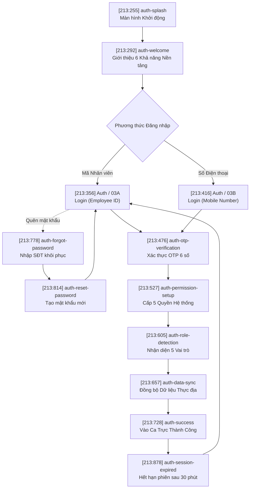

# 🗺️ FLOW MAP • 01 — Authentication & Onboarding

> **Figma Source**: Node ID `213:252` (`FLOW MAP • 01 — Authentication & Onboarding`)  
> **Kích thước Canvas**: 3935 × 2351 px • **Tệp**: `eq0EA9dRSWfS2ivuFohJdg`  
> **Mục tiêu**: Chuẩn hóa luồng khởi động, đăng nhập đa phương thức, phục hồi tài khoản, phân quyền thực địa và khởi tạo đồng bộ dữ liệu ngoại tuyến.

---

## 1. Sơ đồ Luồng Nghiệp vụ (Mermaid Diagram)

---

## 2. Danh mục 14 Màn hình Trong Flow Map 01

| STT | Node ID Figma | Tên Frame Màn Hình | Kích thước | Chức năng Kỹ thuật & Nghiệp vụ |
| :---: | :---: | :--- | :---: | :--- |
| 1 | `213:255` | `auth-splash` | 390 × 844 | Hiển thị phiên bản ứng dụng `v2.4.1`, bản quyền WikiAlisa và biểu tượng xoay tải dữ liệu |
| 2 | `213:292` | `auth-welcome` | 390 × 844 | Giới thiệu 6 trụ cột: GPS thời gian thực, Giao hàng, Lắp đặt, Đảm bảo chất lượng, Xử lý khiếu nại, Xác thực an toàn |
| 3 | `213:356` | `Auth / 03A - Login (Employee ID)` | 390 × 844 | Đăng nhập bằng mã nhân viên (VD: `EMP-2024-897`), mật khẩu mã hóa và nút ghi nhớ đăng nhập |
| 4 | `213:416` | `Auth / 03B - Login (Mobile Number)` | 390 × 844 | Đăng nhập bằng số điện thoại di động đăng ký dành cho đối tác vận chuyển và nông dân |
| 5 | `213:476` | `auth-otp-verification` | 390 × 844 | Nhập 6 ô số OTP, đếm ngược 02:30, nút gửi lại mã và mã hóa AES-256 Bit |
| 6 | `213:527` | `auth-permission-setup` | 390 × 1078 | Cấp phép 5 quyền vận hành: Định vị GPS, Camera chụp ảnh, Lưu đệm ngoại tuyến SQLite, Thông báo đẩy, Bluetooth BLE |
| 7 | `213:605` | `auth-role-detection` | 390 × 844 | Tự động phân định ca trực của 1 trong 5 vai trò (Delivery, Install, QA, Service, Farmer) |
| 8 | `213:657` | `auth-data-sync` | 390 × 844 | Nạp bản đồ ngoại tuyến, danh sách trạm bơm phân công và dữ liệu checklist kỹ thuật |
| 9 | `213:728` | `auth-success` | 390 × 855 | Màn hình thành công, hiển thị tóm tắt lịch trình ca trực và lời chúc bắt đầu ngày làm việc |
| 10 | `213:778` | `auth-forgot-password` | 390 × 844 | Gửi yêu cầu đặt lại mật khẩu bảo mật qua SMS OTP |
| 11 | `213:814` | `auth-reset-password` | 390 × 844 | Nhập mật khẩu mới thỏa mãn độ mạnh: 8 ký tự, chữ hoa, số và ký tự đặc biệt |
| 12 | `213:878` | `auth-session-expired` | 390 × 844 | Bảo mật tự động khóa ứng dụng sau 30 phút không thao tác ngoài thực địa |
| 13 | `19:184` | `auth-forgot-password (alt)` | 390 × 844 | Biến thể giao diện rút gọn cho thiết bị màn hình nhỏ |
| 14 | `19:311` | `auth-reset-password (alt)` | 390 × 844 | Biến thể giao diện nhập mật khẩu kèm gợi ý trực quan |

---

## 3. Quy chuẩn Bảo mật Thực địa (Security Specifications)
- **Mã hóa truyền tải**: Bắt buộc TLS 1.3 và AES-256 đối với mã OTP và chữ ký số.
- **Thời gian hiệu lực**: Phiên đăng nhập tự ngắt sau 30 phút không hoạt động khi thiết bị ở chế độ rảnh.
- **Xác thực ngoại tuyến**: Khi mất sóng viễn thông, nhân viên đã đăng nhập thành công trước đó vẫn có thể sử dụng mã PIN sinh trắc học để tiếp tục ca làm việc.
