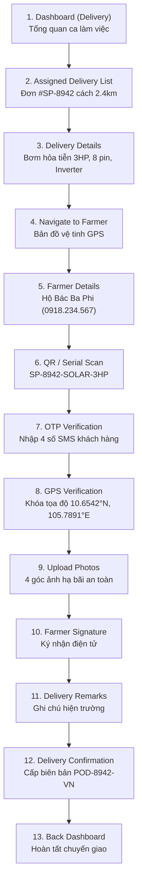

# 🔵 Delivery Flow — Chuỗi Tác Vụ Giao Vận (Del 01 – Del 18)

> **Vai trò**: Delivery Partner (Tài xế giao vận & bàn giao thiết bị trạm bơm mặt trời)  
> **Chuẩn di động**: 390 × 844 px • **Offline-First Ready**

---

## 1. Sơ Đồ Tiến Trình 13 Bước Chi Tiết

---

## 2. Tiêu Chí Nghiệm Thu Từng Bước
1. **Quét mã QR**: Phải khớp chính xác số sê-ri máy bơm trong lệnh điều động xuất kho.
2. **Khóa GPS**: Sai số tọa độ cho phép ≤ 25 mét so với vị trí đã khảo sát.
3. **Chữ ký**: Lưu trữ vector nét vẽ và thời gian epoch UTC.
4. **Mất sóng 4G**: Chuyển ngay sang chế độ Offline Sync, ghi vào bộ đệm SQLite.
