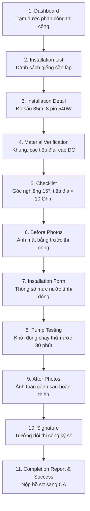

# 🟠 Installation Flow — Quy Trình Thi Công & Lắp Đặt Hệ Thống

> **Vai trò**: Installation Team (Đội ngũ kỹ thuật thi công giàn pin & lắp bơm giếng)  
> **Chuẩn di động**: 390 × 844 px • **Offline-First Ready**

---

## 1. Sơ Đồ Quy Trình 11 Bước

---

## 2. Tiêu Chuẩn Kỹ Thuật Bắt Buộc
- **Góc nghiêng tấm pin**: Cố định hướng chính Nam, góc nghiêng 15° để đón quang năng tối đa.
- **Điện trở tiếp địa**: Phải đạt giá trị kiểm định < 10 Ohm nhằm bảo vệ chống sét.
- **Kiểm tra chạy thử**: Đạt lưu lượng danh định tối thiểu 18 m³/h ở điều kiện bức xạ tiêu chuẩn.
