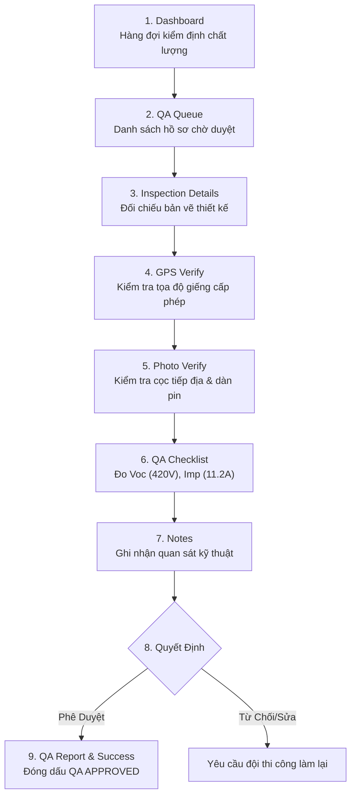

# 🟣 QA Inspection Flow — Quy Trình Kiểm Định & Nghiệm Thu Chất Lượng

> **Vai trò**: QA Inspector (Chuyên viên nghiệm thu chất lượng & an toàn điện mặt trời)  
> **Chuẩn di động**: 390 × 844 px • **Offline-First Ready**

---

## 1. Sơ Đồ Quy Trình 9 Bước

---

## 2. Tiêu Chí Nghiệm Thu Điện Mặt Trời
- **Điện áp hở mạch (Voc)**: Nằm trong dải an toàn 380V – 450V DC.
- **Dòng ngắn mạch/đỉnh (Imp)**: Đạt từ 10.5A – 12.0A khi nắng chuẩn.
- **Quyền lực quyết định**: Phê duyệt QA là quyết định cao nhất, tự động cấp phép kích hoạt đóng điện biến tần.
