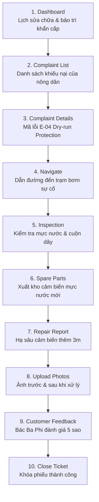

# 🔴 Service & Maintenance Flow — Tiếp Nhận Khiếu Nại & Bảo Trì Sự Cố

> **Vai trò**: Service Technician (Kỹ thuật viên dịch vụ bảo hành & bảo dưỡng trạm bơm)  
> **Chuẩn di động**: 390 × 844 px • **Offline-First Ready**

---

## 1. Sơ Đồ Quy Trình 10 Bước

---

## 2. Các Mã Lỗi Phổ Biến Cần Xử Lý
- `E-01: OVER_VOLTAGE`: Quá áp dàn pin mặt trời do nắng quá gắt hoặc đấu nối sai chuỗi.
- `E-04: DRY_RUN_PROTECTION`: Bơm ngắt an toàn vì nước giếng cạn dưới mức cảm biến.
- `E-07: MOTOR_OVERHEAT`: Động cơ kẹt cát hoặc nhiệt độ biến tần vượt ngưỡng an toàn 75°C.
