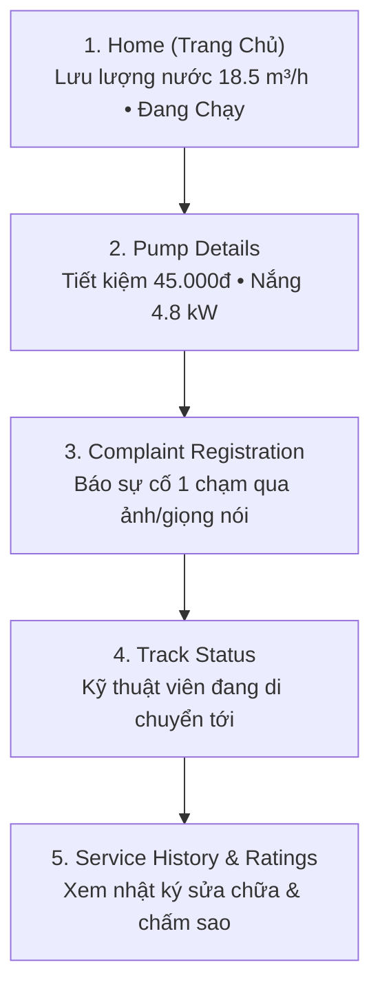

# 🌾 Farmer Flow — Cổng Thông Tin & Giám Sát Của Nông Dân

> **Vai trò**: Farmer / Consumer (Chủ hộ nông dân sử dụng nước tưới vườn cây)  
> **Chuẩn di động**: 390 × 844 px • **Thiết kế thân thiện, chữ lớn, dễ thao tác**

---

## 1. Sơ Đồ Quy Trình 5 Bước

---

## 2. Tiêu Chuẩn Trải Nghiệm Nông Dân
- **Phông chữ lớn & Tương phản cao**: Giúp nông dân quan sát rõ ngoài đồng dưới ánh nắng gắt.
- **Nút bấm khẩn cấp**: Kích thước lớn tối thiểu 56px, chạm ngắt bơm tức thì khi vỡ ống dẫn.
- **Minh bạch chi phí**: Quy đổi trực quan số kilowatt điện mặt trời sinh ra thành số tiền điện tiết kiệm (VNĐ).
