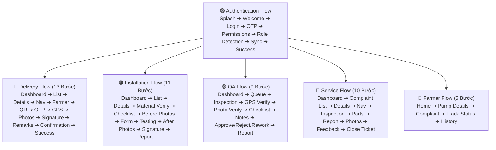

# 📁 04 — Master User Flows & 11 Core Modules Architecture

> **WikiAlisa UI** — Hệ thống quản lý vận hành Trạm Bơm Năng Lượng Mặt Trời (Agriculture Solar Pump Management System).  
> **Cơ sở thiết kế**: Figma File `eq0EA9dRSWfS2ivuFohJdg` (Node `213:252`), chuẩn di động 390 × 844 px, Lưới 8pt Grid, Hỗ trợ Offline-First.

---

## 1. Tổng Quan 5 Luồng Thực Địa Cốt Lõi (Field Journeys)

---

## 2. Chi Tiết Từng Luồng Nghiệp Vụ

### 🟢 1. Authentication & Onboarding Flow
`Splash` ➔ `Welcome` ➔ `Login (Employee ID / Mobile)` ➔ `OTP Verification` ➔ `Permissions Setup (Location, Camera, Storage)` ➔ `Role Detection` ➔ `Sync Configuration (Offline Ready)` ➔ `Success` ➔ Chuyển hướng theo vai trò.
*Chi tiết*: [01-authentication-onboarding-flow.md](file:///c:/Users/Admin/Downloads/wikialisa/user/pages/04-User-Flow/01-authentication-onboarding-flow.md)

### 🔵 2. Delivery Flow (Đối Tác Vận Chuyển)
1. **Delivery Dashboard**: Xem tổng số kiện hôm nay, lộ trình phân bổ.
2. **Assigned Delivery List**: Danh sách trạm bơm cần giao theo thứ tự tối ưu.
3. **Delivery Details**: Thông số thiết bị (Biến tần, 8 tấm pin mặt trời, máy bơm hỏa tiễn).
4. **Navigate to Farmer**: Bản đồ GPS dẫn đường thực địa nông thôn qua kênh rạch.
5. **Farmer Details**: Thông tin chủ hộ, vị trí tập kết bốc dỡ.
6. **QR / Serial Scan**: Quét mã vạch số sê-ri khớp kiện hàng xuất kho.
7. **OTP Verification**: Nông dân cung cấp mã xác thực 6 số.
8. **GPS Verification**: Khóa tọa độ địa lý thực tế bàn giao.
9. **Upload Photos**: Chụp 4 góc ảnh kiện hàng hạ bãi an toàn.
10. **Farmer Signature**: Nông dân ký nhận cảm ứng trên màn hình điện thoại.
11. **Delivery Remarks**: Ghi nhận điều kiện hiện trường (sình lầy, nguồn điện, bờ bao).
12. **Delivery Confirmation**: Cấp mã biên bản bàn giao điện tử POD.
13. **Back Dashboard**: Hoàn tất tác vụ và nhận đơn tiếp theo.
*Chi tiết*: [02-delivery-flow.md](file:///c:/Users/Admin/Downloads/wikialisa/user/pages/04-User-Flow/02-delivery-flow.md)

### 🟠 3. Installation Flow (Đội Ngũ Lắp Đặt)
1. **Installation Dashboard**: Công việc hôm nay, tiến độ thi công các trạm.
2. **Installation List**: Danh sách trạm cần khoan giếng và dựng giàn pin.
3. **Installation Detail**: Thông số kỹ thuật độ sâu giếng, công suất pin (kWp).
4. **Material Verification**: Đối soát vật tư (khung giàn, cọc tiếp địa, dây cáp DC, ống nước).
5. **Checklist**: Hạng mục thi công (Góc nghiêng 15° Nam, giếng sâu 35m, tiếp địa < 10 Ohm).
6. **Before Photos**: Chụp ảnh mặt bằng hiện trạng trước khi thi công.
7. **Installation Form**: Ghi chép chiều sâu mực nước tĩnh, mực nước động.
8. **Pump Testing**: Khởi động mồi nước, đo áp lực ống xả và lưu lượng ban đầu.
9. **After Photos**: Chụp 4 góc trạm bơm hoàn thiện nghiệm thu cơ điện.
10. **Signature**: Đại diện kỹ thuật đội thi công ký số xác nhận.
11. **Completion Report & Success**: Nộp hồ sơ lắp đặt sang hàng chờ kiểm định QA.
*Chi tiết*: [03-installation-flow.md](file:///c:/Users/Admin/Downloads/wikialisa/user/pages/04-User-Flow/03-installation-flow.md)

### 🟣 4. QA Inspection Flow (Kiểm Định Viên QA)
1. **QA Dashboard**: Các trạm chờ nghiệm thu, tỷ lệ đạt chuẩn, cảnh báo lỗi.
2. **QA Queue**: Hàng đợi hồ sơ do đội lắp đặt gửi sang.
3. **Inspection Details**: Đối chiếu hồ sơ trắc địa và bản vẽ lắp đặt.
4. **GPS Verify**: Xác minh tọa độ giếng khoan thực tế có nằm trong phạm vi cấp phép.
5. **Photo Verify**: Kiểm tra độ nét ảnh cọc tiếp địa, mối hàn và mặt pin.
6. **QA Checklist**: Đo kiểm điện áp Voc, dòng tải Imp, độ cách điện cuộn dây.
7. **Notes & Observations**: Ghi nhận các điểm lưu ý kỹ thuật.
8. **Decision (Approve / Reject / Rework)**: Phê duyệt cấp phép HOẶC yêu cầu thi công lại.
9. **QA Report & Success**: Cấp tem kiểm định điện tử và kích hoạt trạm bơm vào lưới.
*Chi tiết*: [04-qa-inspection-flow.md](file:///c:/Users/Admin/Downloads/wikialisa/user/pages/04-User-Flow/04-qa-inspection-flow.md)

### 🔴 5. Service & Maintenance Flow (Kỹ Thuật Viên Dịch Vụ)
1. **Service Dashboard**: Phiếu bảo hành mở, yêu cầu sự cố khẩn cấp, lịch bảo dưỡng.
2. **Complaint List**: Danh sách khiếu nại của nông dân (bơm không lên nước, báo lỗi E-04).
3. **Complaint Details**: Lịch sử vận hành và chẩn đoán sơ bộ từ xa qua IoT.
4. **Navigate**: Dẫn đường đến giếng trạm bơm sự cố.
5. **Inspection**: Kiểm tra thực địa máy bơm, đường dây và tủ điều khiển inverter.
6. **Spare Parts**: Xuất kho linh kiện thay thế (cảm biến mực nước, tụ điện, quạt tản nhiệt).
7. **Repair Report**: Nhật ký xử lý và nguyên nhân sự cố.
8. **Upload Photos**: Ảnh linh kiện cũ hỏng và linh kiện mới sau thay thế.
9. **Customer Feedback**: Thu thập đánh giá sao và chữ ký xác nhận của nông dân.
10. **Close Ticket**: Khóa phiếu bảo trì, cập nhật nhật ký thiết bị lên đám mây.
*Chi tiết*: [05-service-flow.md](file:///c:/Users/Admin/Downloads/wikialisa/user/pages/04-User-Flow/05-service-flow.md)

### 🌾 6. Farmer Flow (Nông Dân Chủ Hộ)
1. **Farmer Home**: Xem trạng thái trạm bơm (Đang chạy / Nghỉ), lưu lượng nước m³/h.
2. **Pump Details**: Sản lượng điện mặt trời tiết kiệm (kWh / VNĐ), số giờ chạy trong ngày.
3. **Complaint Registration**: Báo sự cố 1 chạm (chụp ảnh giếng hoặc ghi âm giọng nói).
4. **Track Status**: Theo dõi kỹ thuật viên đang di chuyển đến hỗ trợ.
5. **Service History & Ratings**: Xem lại lịch sử các đợt bảo trì và đánh giá chất lượng.
*Chi tiết*: [06-farmer-flow.md](file:///c:/Users/Admin/Downloads/wikialisa/user/pages/04-User-Flow/06-farmer-flow.md)

---

## 3. Kiến Trúc 11 Modules Toàn Diện

Bao gồm chi tiết danh mục màn hình cho 11 modules:
* [11-modules-architecture.md](file:///c:/Users/Admin/Downloads/wikialisa/user/pages/04-User-Flow/11-modules-architecture.md)
  - **Module 1**: Authentication (10 màn)
  - **Module 2**: Global Navigation (8 màn dùng chung)
  - **Module 3**: Dashboards (5 biến thể cho 5 vai trò)
  - **Module 4**: Delivery (10 màn)
  - **Module 5**: Installation (11 màn)
  - **Module 6**: QA Inspection (10 màn)
  - **Module 7**: Service & Complaints (11 màn)
  - **Module 8**: Farmer Experience (8 màn)
  - **Module 9**: Notifications (3 màn)
  - **Module 10**: Profile & Settings (5 màn)
  - **Module 11**: Edge Cases (Empty, Error, Loading, Success States)
