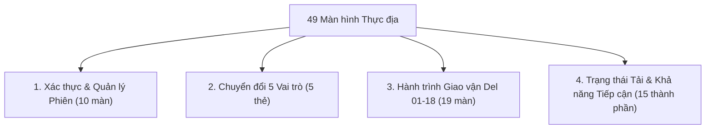

# 📁 06 — High-Fidelity UI (49 Màn hình Di động Chuẩn 390px)

> **Figma File**: `eq0EA9dRSWfS2ivuFohJdg` • **Page ID**: `9:78` (`📁 06 High-Fidelity UI`)  
> **Chuẩn thiết kế**: Mobile First (Apple iPhone 14/15 — 390 × 844 px), Lưới 8pt Grid, Độ tương phản WCAG 2.1 AA.  
> **Danh mục kỹ thuật JSON**: [screens-catalog.json](file:///c:/Users/Admin/Downloads/wikialisa/user/pages/06-High-Fidelity-UI/screens-catalog.json)

---

## 1. Tổng quan Phân loại 49 Màn hình Thực địa

Hệ thống màn hình độ nét cao (High-Fidelity) được chia thành 4 nhóm nghiệp vụ chính:

---

## 2. Danh mục Ma trận Màn hình Chi tiết (Node ID Figma)

### Nhóm 1: Xác thực & Bảo mật Phiên làm việc (Authentication & Session Security)
| STT | Node ID Figma | Tên Màn Hình / Frame | Kích thước | Mô tả Nghiệp vụ |
| :---: | :---: | :--- | :---: | :--- |
| 1 | `19:139` | `auth-otp-verification` | 390 × 844 | Nhập mã OTP 6 số bàn giao, bảo mật mã hóa AES-256 |
| 2 | `19:368` | `auth-session-expired` | 390 × 844 | Hết hạn phiên làm việc sau 30 phút không hoạt động |
| 3 | `19:398` | `auth-permission-setup` | 390 × 1078 | Cấp quyền hệ thống: GPS, Camera, Lưu đệm ngoại tuyến |
| 4 | `19:470` | `auth-role-detection` | 390 × 844 | Tự động phân luồng vai trò sau khi xác thực |
| 5 | `19:516` | `auth-data-sync` | 390 × 844 | Đồng bộ ban đầu dữ liệu tuyến đường và danh sách trạm bơm |
| 6 | `19:695` | `auth-success` | 390 × 855 | Chào mừng vào ca trực, tóm tắt nhiệm vụ trong ngày |
| 7 | `19:812` | `auth-loading-states` | 390 × 856 | Các trạng thái Skeleton loading, bộ xoay vòng đồng bộ |
| 8 | `19:994` | `You Are Currently Offline` | 358 × 253 | Modal cảnh báo chuyển sang chế độ ngoại tuyến |
| 9 | `19:983` | `Session Expiring Soon` | 358 × 235 | Modal nhắc nhở sắp hết phiên làm việc kèm đồng hồ đếm ngược |
| 10 | `19:972` | `Confirm Operational Logout?` | 358 × 235 | Modal xác nhận đăng xuất và kiểm tra hàng đợi đồng bộ |

---

### Nhóm 2: Thẻ Chuyển đổi 5 Nhóm Người dùng (Role Switcher Matrix)
| STT | Node ID Figma | Tên Thẻ Linh Kiện | Kích thước | Vai trò Thực địa |
| :---: | :---: | :--- | :---: | :--- |
| 11 | `22:169` | `1. Delivery Partner` | 358 × 83 | Tài xế giao vận & bàn giao kiện máy bơm/pin |
| 12 | `22:190` | `2. Installation Team` | 358 × 83 | Đội ngũ thi công, đóng cọc tiếp địa & đấu nối inverter |
| 13 | `22:209` | `3. QA Inspector` | 358 × 83 | Chuyên viên nghiệm thu điện áp Voc/Imp và lưu lượng nước |
| 14 | `22:230` | `4. Service Technician` | 358 × 83 | Kỹ thuật viên bảo hành, khắc phục lỗi báo cạn E-04 |
| 15 | `22:249` | `5. Farmer (Consumer)` | 358 × 83 | Nông dân chủ hộ bật/tắt bơm và theo dõi sản lượng điện |

---

### Nhóm 3: Chuỗi Tác Vụ Giao Vận Thực Địa Toàn Diện (Del 01 – Del 18)
| STT | Node ID Figma | Tên Màn Hình / Frame | Kích thước | Mô tả Chức năng |
| :---: | :---: | :--- | :---: | :--- |
| 16 | `60:63` | `Dash / 01 - Delivery Partner` | 390 × 1139 | Dashboard điều hành giao vận ca trực |
| 17 | `32:2489` | `Del / 01 - Delivery List` | 390 × 1012 | Danh sách đơn hàng cần giao theo thứ tự tối ưu |
| 18 | `32:2620` | `Del / 02 - Delivery Details` | 390 × 1232 | Chi tiết cấu hình trạm bơm và thông tin liên hệ hộ dân |
| 19 | `32:2752` | `Del / 03 - Route Navigation` | 390 × 844 | Dẫn đường GPS thực địa, cảnh báo đường hẹp/cầu khỉ |
| 20 | `32:2963` | `Del / 04 - Farmer Contact` | 390 × 1083 | Màn hình quay số gọi điện và ghi chú thời gian hẹn |
| 21 | `32:3062` | `Del / 05 - OTP Verification` | 390 × 939 | Xác thực mã nhận hàng do nông dân cung cấp |
| 22 | `32:3133` | `Del / 06 - Serial Verification` | 390 × 1032 | Quét QR mã vạch đối soát sê-ri bơm & biến tần |
| 23 | `32:3296` | `Del / 07 - Photo Upload` | 390 × 935 | Chụp 4 góc ảnh hạ hàng an toàn (kèm Watermark tọa độ) |
| 24 | `32:3376` | `Del / 08 - Farmer Signature` | 390 × 844 | Bảng lấy chữ ký cảm ứng của nông dân |
| 25 | `32:3430` | `Del / 09 - GPS Verification` | 390 × 844 | Khóa tọa độ địa lý bàn giao chính xác |
| 26 | `32:3531` | `Del / 10 - Delivery Remarks` | 390 × 888 | Ghi nhận ghi chú hiện trường (mặt bằng, nguồn giếng) |
| 27 | `32:3605` | `Del / 11 - Delivery Confirmation` | 390 × 844 | Biên bản giao hàng hoàn tất (POD) phát sinh mã điện tử |
| 28 | `32:3687` | `Del / 12 - Offline Sync` | 390 × 1094 | Quản lý hàng đợi đồng bộ ngoại tuyến |
| 29 | `32:3886` | `Del / 13 - Delivery Timeline` | 390 × 1160 | Lịch sử tiến trình ca giao hàng |
| 30 | `32:4037` | `Del / 14 - Dashboard Widgets` | 390 × 1003 | Các widget chỉ số hiệu suất giao hàng trong ngày |
| 31 | `32:4137` | `Del / 15 - Bottom Sheets` | 390 × 1347 | Bảng trượt thao tác nhanh và báo cáo sự cố |
| 32 | `35:4394` | `Del / 16 - Dialogs` | 390 × 1145 | Hộp thoại cảnh báo hủy chuyến hoặc chuyển ca |
| 33 | `35:4461` | `Del / 17 - Empty States` | 390 × 1269 | Giao diện trạng thái rỗng khi hết đơn hàng |
| 34 | `35:4515` | `Del / 18 - Error States` | 390 × 1135 | Màn hình lỗi mạng, sai mã thiết bị hoặc mất định vị |

---

### Nhóm 4: Hệ Thống, Trạng Thái Tải & Khả Năng Tiếp Cận
| STT | Node ID Figma | Tên Màn Hình / Frame | Kích thước | Tính năng Kỹ thuật |
| :---: | :---: | :--- | :---: | :--- |
| 35 | `36:4633` | `Screen-19-Loading-States` | 390 × 1208 | Hiệu ứng tải dữ liệu Shimmer, bộ đếm phần trăm |
| 36 | `36:4707` | `Screen-20-Accessibility` | 390 × 1412 | Chế độ tương phản cao, cỡ chữ lớn hỗ trợ người cao tuổi |
| 37-49 | `19:763 - 213:1047` | *Sub-frames & Modal Overlays* | 358 × 253 | Các khung thông báo phụ và nút điều hướng |

---

## 3. Liên kết Trải nghiệm Trực tiếp
Toàn bộ chuỗi màn hình thực địa được kết nối và mô phỏng tương tác tại:
* **Simulator**: [https://wikialisa.github.io/UI#simulator](https://wikialisa.github.io/UI#simulator)
* **Design System**: [https://wikialisa.github.io/UI#components](https://wikialisa.github.io/UI#components)
