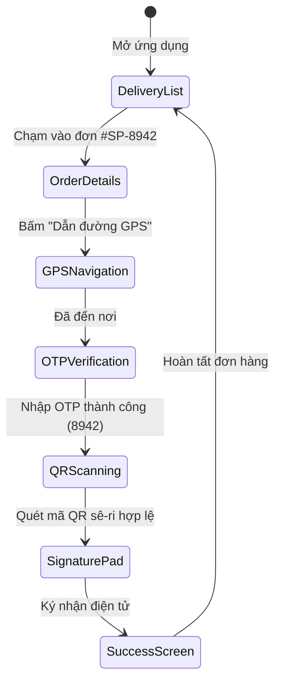

# 📁 08 — Prototype & Interactive Flows

> **WikiAlisa UI** — Trực tiếp trải nghiệm Interactive Prototype tại: [https://wikialisa.github.io/UI#simulator](https://wikialisa.github.io/UI#simulator)

---

## 1. Tổng quan Kiến trúc Nguyên mẫu (Prototype State Machine)
Nguyên mẫu tương tác được phát triển trên khung di động chuẩn **390 × 844 px (Mobile First)** theo mô hình máy trạng thái hữu hạn (**Finite State Machine**), hỗ trợ đầy đủ 5 vai trò thực địa và 3 kịch bản vận hành thực tế.

---

## 2. Chi tiết 3 Kịch bản Tương tác (Scenarios)

### A. Kịch bản Thành công (Happy Path)
- **Delivery Partner**:
  - **Bước 1**: Danh sách đơn hàng thực địa với thẻ nổi bật `#SP-8942` cách 2.4 km.
  - **Bước 2**: Chi tiết cấu hình thiết bị (Bơm hỏa tiễn 3HP, 8 tấm pin 540W Mono, biến tần MPPT 2.2kW) & liên hệ chủ hộ Bác Ba Phi.
  - **Bước 3**: Bản đồ định vị GPS với tọa độ thực tế `10.6542° N, 105.7891° E`.
  - **Bước 4**: Bàn phím số tương tác ảo nhập mã OTP 4 chữ số (mã test nhanh: `8942`).
  - **Bước 5**: Kính ngắm mô phỏng quét mã QR nhận diện số sê-ri `SP-8942-SOLAR-3HP`.
  - **Bước 6**: Vùng ký tên cảm ứng số hóa của nông dân.
  - **Bước 7**: Màn hình xác nhận thành công rực rỡ, cấp mã biên bản giao vận `POD-8942-VN`.
- **Installation Team**:
  - Checklist kỹ thuật tương tác 3 mục (Góc nghiêng 15°, Độ sâu giếng 35m, Tiếp địa an toàn < 10 Ohm).
  - Thanh tiến trình thực tế (`0% ➔ 33% ➔ 67% ➔ 100%`).
  - Nút chuyển hồ sơ sang hàng chờ QA khi tích đủ điều kiện.
- **QA Inspector**:
  - Bảng đo kiểm thông số kỹ thuật (Voc 420V, Imp 11.2A, Lưu lượng 19.2 m³/h).
  - Nút phê duyệt: Đóng dấu động `★ ĐÃ PHÊ DUYỆT NGHIỆM THU (QA APPROVED) ★`.
- **Farmer Portal**:
  - Giao diện thẻ năng lượng mặt trời công suất cao.
  - Nút công tắc Bật/Tắt máy bơm khẩn cấp tương tác thời gian thực: chuyển trạng thái từ `ĐANG CHẠY` (18.5 m³/h) sang `ĐÃ DỪNG` (0.0 m³/h).

---

### B. Kịch bản Bắt lỗi & Phục hồi (Error & Recovery Path)
- **Delivery GPS**: Cảnh báo lệch tọa độ giếng khoan thực địa `120m` so với tọa độ cấp phép.
- **OTP Verification**: Khi nhập sai mã khác `8942`, hệ thống báo lỗi đỏ và yêu cầu nhập lại hoặc dùng nút phím tắt "Mẫu".
- **QA Inspection**: Khi bấm nút "Từ chối", hệ thống gán nhãn `✖ TỪ CHỐI NGHIỆM THU (QA REJECTED)` và yêu cầu đội thi công căn chỉnh lại góc nghiêng dàn pin.

---

### C. Kịch bản Mất sóng Ngoại tuyến (Offline-First Path)
- Mô phỏng hoàn cảnh mất kết nối di động 4G tại vùng sâu vùng xa đồng bằng sông Cửu Long.
- Biểu ngữ thông báo màu đỏ: `Mất sóng 4G (Offline Mode) • ☁️ 3 Pending`.
- Toàn bộ dữ liệu checklist, chữ ký và thao tác giao nhận được ghi nhận vào bộ nhớ đệm cục bộ và kích hoạt đồng bộ khi có mạng trở lại.

---

## 3. Cách Thức Thử Nghiệm Trên Trình Duyệt
1. Mở trang showcase: [https://wikialisa.github.io/UI#simulator](https://wikialisa.github.io/UI#simulator)
2. Chọn vai trò (Role 1 đến 5).
3. Chọn kịch bản (**Happy Path**, **Error Path**, hoặc **Offline Path**).
4. Tương tác trực tiếp trên màn hình điện thoại 390px (chạm, bấm phím số, chuyển bước, gạt công tắc).
5. Bấm nút `🔄 Reset Flow` bất kỳ lúc nào để bắt đầu lại chu trình.
